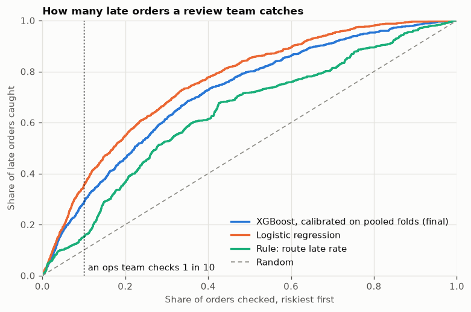
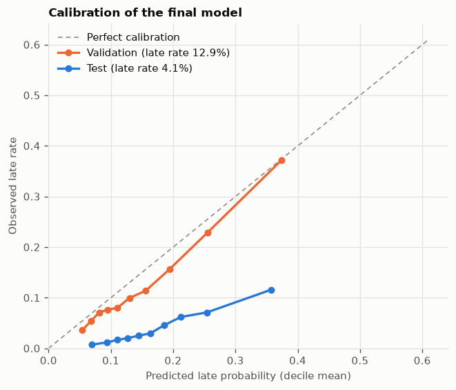
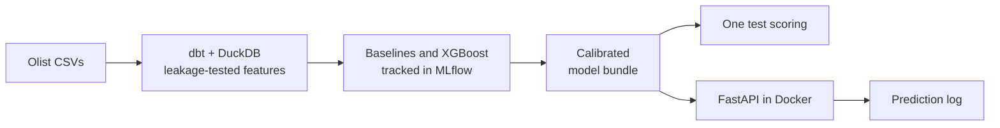

# OpsPilot AI

Predicts which e-commerce orders will arrive late, using only what was known
when the order was approved, and serves the prediction with its reasons from a
Dockerized API.



## The problem

About 7% of delivered orders on the [Olist](data/README.md) marketplace arrive
after their promised date. An operations team cannot review every order, so the
useful question is: if we can check 1 order in 10 when it is approved, which
ones, and how many late orders do we catch?

The hard part is honesty. On this dataset it is easy to get great results that
would never hold up: seller statistics that peek at the future, random splits,
recent orders that only look on time because the slow ones have not arrived yet.
This project is built to avoid those traps and to report what is left.

## Results

Scored **once** on the test set (April to mid-July 2018, 21,949 orders, 4.05%
late), after the model and evaluation plan were committed in
[test_protocol.md](reports/test_protocol.md).

| Model | PR-AUC (95% CI) | Late orders caught in riskiest 10% |
| --- | --- | ---: |
| Random | 0.041 | 10.0% |
| Rule: route late rate | 0.067 (0.061 to 0.075) | 15.2% |
| **XGBoost, calibrated (final)** | **0.094 (0.086 to 0.105)** | **28.6%** |
| Logistic regression | 0.116 (0.105 to 0.129) | 35.3% |

- **The final model works:** it catches almost three times as many late orders as
  random checks and nearly twice as many as the simple rules.
- **It is not the best model on test.** XGBoost led logistic regression on
  validation, and the order flipped on test. The model was not switched afterwards:
  that was the commitment, and no later data exists to settle it. Monthly
  retraining raised XGBoost's catch rate in every test month, which is the v2
  direction.

Full details: [evaluation](reports/evaluation.md),
[model card](reports/model_card.md),
[how the model was chosen](reports/model_selection.md),
[error analysis](notebooks/02_error_analysis.ipynb).

## Calibration under prevalence shift

The late rate moves a lot: 13% on validation, 4% on test, and between 1% and 19%
month to month. A calibrator learns the base rate of the data it sees, so
probabilities calibrated on 2017 and early 2018 came out about four times too high
on the calm test period (17.2% predicted on average, 4.05% actual).



Ranking held and calibration drifted: each risk decile is still riskier than the
one before, but every level sits too high. Better static calibration cannot fix
this, because no calibrator knows the next period's late rate. The fix is to
monitor predicted against observed late rate and recalibrate, which is why the API
logs every prediction and why v2 adds drift monitoring. The comparison of
calibration options is in [ADR 0006](docs/decisions/0006-calibration-under-shift.md).

## How it works



More in [docs/architecture.md](docs/architecture.md). Each decision that shapes the
results has a short record with its numbers
([EDA notebook](notebooks/01_eda.ipynb)):

1. [Target definition](docs/decisions/0001-target-definition.md): late means delivered after the promised calendar date. 96,470 of 99,441 orders are labeled; cancelled and undelivered orders are excluded.
2. [Prediction time](docs/decisions/0002-prediction-time.md): features must be known when the order is approved.
3. [Censoring cutoff](docs/decisions/0003-censoring-cutoff.md): the 10,201 labeled orders purchased after 2018-07-15 are dropped, because their slow deliveries are missing from the data.
4. [Chronological split](docs/decisions/0004-chronological-split.md): train on 2017, validate on Q1 2018, test on April to mid-July 2018. Every fit only learns outcomes already known when it would be used, and features that act as a calendar are removed.
5. [Leakage rules](docs/decisions/0005-leakage-rules.md): nothing recorded after approval, history only from events before it. Two independent checks enforce this, and both were tried against the mistake they exist to catch.
6. [Calibration under shift](docs/decisions/0006-calibration-under-shift.md): options are replayed one period back in time, never scored on test.

## Limitations

- **Probabilities need recalibrating** on recent outcomes before their level can be
  trusted; use the ranking or risk band until then.
- **What happens after approval is invisible.** Many late orders come from a seller
  handing over weeks late or from a long carrier leg.
- **Batch scoring, not a live service.** The API looks up features built in the
  warehouse, or takes them from the caller. A live system would compute history
  features at request time.
- **Risk follows geography.** The riskiest 10% holds 80% of late orders bound for Rio
  de Janeiro and 9% of those bound for São Paulo. See the
  [fairness note](reports/model_card.md#fairness); do not use the score to penalise
  sellers.
- **Old, single-marketplace data:** one Brazilian marketplace, 2016 to 2018.

## Run it

Requires [uv](https://docs.astral.sh/uv/) (it installs Python 3.11) and, for the
API, Docker. On macOS, XGBoost also needs OpenMP: `brew install libomp`.

```bash
make all
```

That downloads the data and rebuilds the warehouse, features, model and test report
from the raw CSVs. `make help` lists each stage. To try the warehouse and all tests
on the small committed sample, without downloading anything:

```bash
make test
```

Then serve the model:

```bash
docker compose up --build
```

```bash
curl -X POST localhost:8000/predict -H 'content-type: application/json' -d '{"order_id": "7af07887f8840085ae4b65cb52f4af29"}'
```

The response has the probability, a risk band, the model version and the top three
reasons. API docs are at <http://localhost:8000/docs> and the MLflow UI at
<http://localhost:5001>. The risk bands were set on validation; on test they ran
1.8% (low), 6.0% (medium) and 12.0% (high) late.

## Roadmap for v2

- Monthly retraining, orchestrated with Airflow.
- Monitoring predicted against observed late rate from the prediction log, with
  recalibration when they drift, and a CI evaluation gate.
- Re-scoring each order at carrier handover, when seller delays become visible.
- History features computed at request time, deployed with Terraform on ECS.
- An agent layer for operations teams.

## License

Code: [MIT](LICENSE). Data: CC BY-NC-SA 4.0, owned by Olist; see
[data/README.md](data/README.md).
