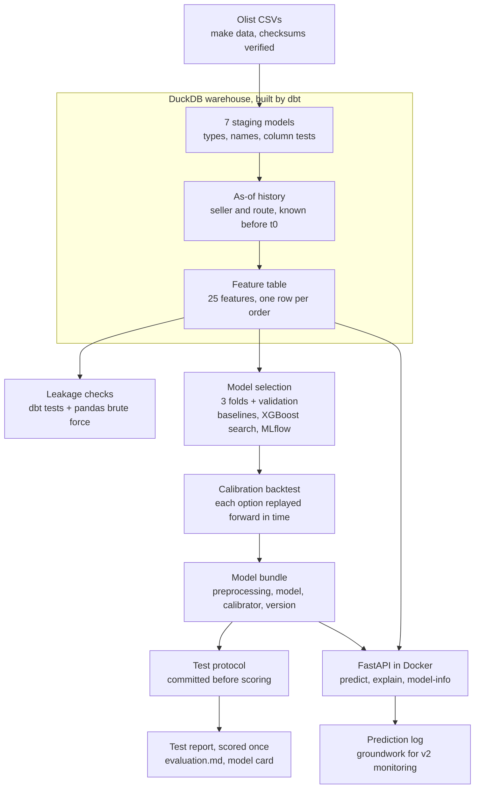

# Architecture

The v1 pipeline, from raw CSVs to a served prediction. `make all` runs everything
up to the test report; `docker compose up` serves the result.

| Stage | Code | Output |
| --- | --- | --- |
| Download | `src/opspilot/data/` | `data/raw/` (gitignored), `data/sample/` for CI |
| Warehouse | `warehouse/` | `warehouse/opspilot.duckdb` |
| Selection | `src/opspilot/models/` | MLflow runs, `artifacts/`, `reports/selection_tables.md` |
| Evaluation | `src/opspilot/models/evaluate.py` | `reports/evaluation.md`, `reports/figures/` |
| Serving | `src/opspilot/api/`, `docker/` | the API on port 8000, the MLflow UI on port 5001 |

CI runs lint, the warehouse and its tests, all Python tests, the whole pipeline on
the sample with a tiny search, and the API image build.
