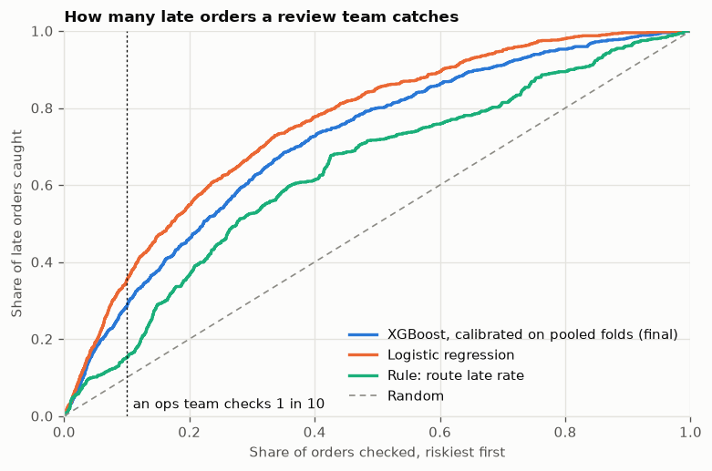
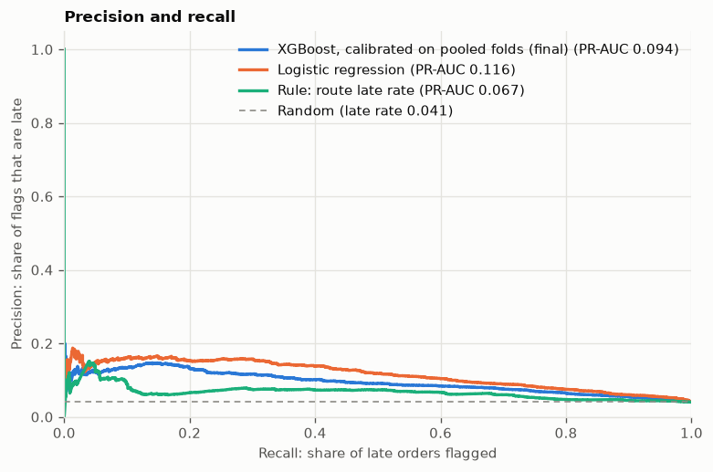
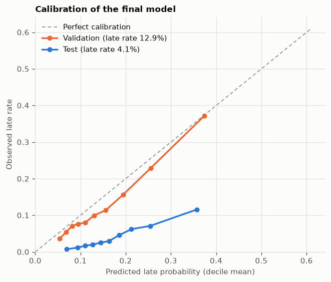
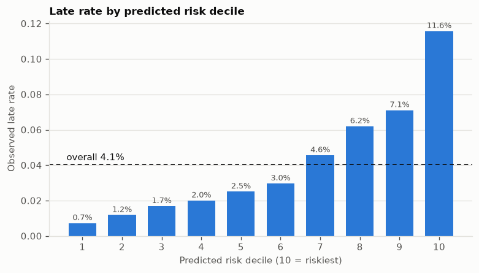
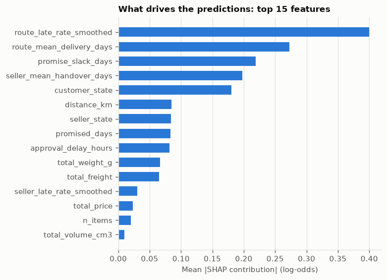

# Evaluation

Generated by `make evaluate` on 2026-10-26 at commit `f6431bc`; do not edit by hand. The test set (2018-04-01 to 2018-07-15, 21,949 orders, late rate 4.05%) is scored by the frozen bundle `2026.10.26+01a157f`. Baselines are fitted on train only.

- Prediction fingerprint: `6da76c34b8f3ba6dbee598aa81f78b72bcfd4d00f9366a87cb4035c851f911b8`
- Matches the fingerprint in `reports/test_protocol.md`: **yes**
- Bundle file SHA-256: `cd491aa873591dc601a280726bb2891395eed2ed064dfbb605286d950cd94a4f`

## Results

Lift is PR-AUC divided by the late rate; a random model scores 1. Intervals come from 1,000 bootstrap resamples of the scored orders.

| Model | PR-AUC (95% CI) | Lift | ROC-AUC | Precision @ top 10% | Recall @ top 10% (95% CI) | Brier | ECE | Mean prediction |
| --- | --- | --- | --- | --- | --- | --- | --- | --- |
| Prior (train late rate) | 0.041 (0.038 to 0.043) | 1.000 | 0.500 | 0.041 | 0.100 (0.100 to 0.100) | 0.039 | 0.016 | 0.056 |
| Rule: seller smoothed late rate | 0.050 (0.045 to 0.056) | 1.231 | 0.540 | 0.066 | 0.162 (0.140 to 0.186) | 0.041 | 0.030 | 0.070 |
| Rule: route late rate | 0.067 (0.061 to 0.075) | 1.657 | 0.642 | 0.062 | 0.152 (0.129 to 0.173) | 0.040 | 0.028 | 0.069 |
| Logistic regression | 0.116 (0.105 to 0.129) | 2.852 | 0.767 | 0.143 | 0.353 (0.324 to 0.383) | 0.039 | 0.032 | 0.073 |
| XGBoost, uncalibrated | 0.094 (0.086 to 0.105) | 2.319 | 0.722 | 0.116 | 0.286 (0.260 to 0.315) | 0.041 | 0.051 | 0.092 |
| XGBoost, calibrated on validation | 0.094 (0.086 to 0.105) | 2.319 | 0.722 | 0.116 | 0.286 (0.260 to 0.315) | 0.057 | 0.129 | 0.169 |
| XGBoost, calibrated on pooled folds (final) | 0.094 (0.086 to 0.105) | 2.319 | 0.722 | 0.116 | 0.286 (0.260 to 0.315) | 0.058 | 0.131 | 0.172 |

## The final model against the strongest baselines

Paired bootstrap: the same resampled orders for both models.

| Final model compared with | PR-AUC difference (95% CI) | Top-10% recall difference (95% CI) |
| --- | --- | --- |
| Logistic regression | -0.022 (-0.030 to -0.013) | -0.067 (-0.095 to -0.037) |
| Rule: route late rate | 0.027 (0.020 to 0.035) | 0.134 (0.109 to 0.161) |

## Capacity: how many late orders a review team catches

If an operations team can check the riskiest 10% of orders, the final model points it to 28.6% of all late orders, and 11.6% of the orders it checks turn out late.

| Model | Check 5% | Check 10% | Check 20% | Check 30% |
| --- | --- | --- | --- | --- |
| XGBoost, calibrated on pooled folds (final) | 0.175 | 0.286 | 0.461 | 0.614 |
| Logistic regression | 0.191 | 0.353 | 0.549 | 0.679 |
| Rule: route late rate | 0.101 | 0.152 | 0.367 | 0.526 |
| Prior (train late rate) | 0.050 | 0.100 | 0.200 | 0.300 |

## Calibration

Validation was part of the final calibrator's fitting data; the test curve is the out-of-time check.

## Slices

The final model by slice. Slices with fewer than 200 orders are flagged as unreliable. The recall column uses the global top-10% cut-off.

### By customer state

| customer_state | Orders | Late rate | Mean prediction | ROC-AUC | Lift | Late orders in global top 10% | Reliable |
| --- | --- | --- | --- | --- | --- | --- | --- |
| SP | 9877 | 0.024 | 0.133 | 0.696 | 3.621 | 0.089 | yes |
| RJ | 2576 | 0.042 | 0.279 | 0.740 | 2.366 | 0.796 | yes |
| MG | 2465 | 0.037 | 0.162 | 0.759 | 2.850 | 0.167 | yes |
| RS | 1120 | 0.026 | 0.162 | 0.674 | 2.091 | 0.034 | yes |
| PR | 1114 | 0.027 | 0.160 | 0.650 | 3.811 | 0.067 | yes |
| SC | 760 | 0.025 | 0.178 | 0.706 | 2.409 | 0.105 | yes |
| BA | 740 | 0.139 | 0.225 | 0.631 | 1.644 | 0.340 | yes |
| DF | 489 | 0.041 | 0.189 | 0.715 | 4.084 | 0.200 | yes |
| ES | 445 | 0.119 | 0.197 | 0.635 | 1.313 | 0.075 | yes |
| GO | 427 | 0.040 | 0.187 | 0.724 | 2.200 | 0.176 | yes |
| PE | 362 | 0.086 | 0.229 | 0.627 | 1.433 | 0.355 | yes |
| CE | 284 | 0.109 | 0.244 | 0.730 | 2.273 | 0.613 | yes |
| MT | 206 | 0.019 | 0.185 | 0.736 | 2.693 | 0.250 | yes |
| PA | 177 | 0.147 | 0.174 | 0.661 | 1.788 | 0.269 | no, under 200 orders |
| MS | 146 | 0.055 | 0.184 | 0.724 | 2.668 | 0.375 | no, under 200 orders |
| MA | 135 | 0.126 | 0.293 | 0.664 | 1.718 | 0.706 | no, under 200 orders |
| PB | 109 | 0.073 | 0.222 | 0.527 | 1.121 | 0.250 | no, under 200 orders |
| PI | 106 | 0.189 | 0.237 | 0.609 | 1.589 | 0.500 | no, under 200 orders |
| RN | 101 | 0.109 | 0.216 | 0.566 | 1.293 | 0.273 | no, under 200 orders |
| AL | 81 | 0.136 | 0.270 | 0.594 | 1.880 | 0.455 | no, under 200 orders |
| TO | 61 | 0.098 | 0.218 | 0.821 | 6.583 | 0.667 | no, under 200 orders |
| SE | 54 | 0.167 | 0.223 | 0.674 | 1.858 | 0.444 | no, under 200 orders |
| RO | 47 | 0.000 | 0.148 | n/a | n/a | n/a | no, under 200 orders |
| AM | 29 | 0.000 | 0.129 | n/a | n/a | n/a | no, under 200 orders |
| AP | 19 | 0.000 | 0.137 | n/a | n/a | n/a | no, under 200 orders |
| RR | 10 | 0.100 | 0.137 | 0.889 | 5.000 | 0.000 | no, under 200 orders |
| AC | 9 | 0.111 | 0.117 | 0.250 | 1.286 | 0.000 | no, under 200 orders |

### Top 10 product categories

| main_category | Orders | Late rate | Mean prediction | ROC-AUC | Lift | Late orders in global top 10% | Reliable |
| --- | --- | --- | --- | --- | --- | --- | --- |
| health_beauty | 2364 | 0.060 | 0.165 | 0.766 | 3.018 | 0.308 | yes |
| bed_bath_table | 2023 | 0.038 | 0.174 | 0.715 | 2.002 | 0.208 | yes |
| watches_gifts | 1702 | 0.047 | 0.175 | 0.704 | 2.129 | 0.212 | yes |
| housewares | 1505 | 0.037 | 0.170 | 0.716 | 2.684 | 0.291 | yes |
| sports_leisure | 1490 | 0.038 | 0.162 | 0.784 | 3.838 | 0.393 | yes |
| computers_accessories | 1357 | 0.029 | 0.142 | 0.742 | 2.606 | 0.179 | yes |
| furniture_decor | 1325 | 0.035 | 0.193 | 0.713 | 1.904 | 0.383 | yes |
| auto | 999 | 0.050 | 0.186 | 0.711 | 2.543 | 0.280 | yes |
| telephony | 735 | 0.041 | 0.189 | 0.654 | 2.916 | 0.333 | yes |
| baby | 700 | 0.039 | 0.174 | 0.755 | 2.729 | 0.407 | yes |

### By purchase month

| month | Orders | Late rate | Mean prediction | ROC-AUC | Lift | Late orders in global top 10% | Reliable |
| --- | --- | --- | --- | --- | --- | --- | --- |
| 2018-04 | 6798 | 0.045 | 0.181 | 0.739 | 2.677 | 0.382 | yes |
| 2018-05 | 6749 | 0.066 | 0.179 | 0.699 | 1.894 | 0.237 | yes |
| 2018-06 | 6096 | 0.012 | 0.147 | 0.699 | 2.918 | 0.225 | yes |
| 2018-07 | 2306 | 0.030 | 0.186 | 0.599 | 1.443 | 0.232 | yes |

## Explanations

SHAP contributions of the uncalibrated model, in log-odds; one-hot columns are summed back into their feature. A positive contribution pushes an order toward late.

| Order | Predicted | Actual | Reason 1 | Reason 2 | Reason 3 |
| --- | --- | --- | --- | --- | --- |
| Riskiest order that was late | 0.578 | late | route_late_rate_smoothed = 0.14 (+0.59) | customer_state = RJ (+0.52) | promise_slack_days = 0.88 (+0.50) |
| Riskiest order that arrived on time | 0.611 | on time | route_late_rate_smoothed = 0.15 (+0.58) | customer_state = RJ (+0.52) | promise_slack_days = -0.31 (+0.51) |
| Late order the model rated safest | 0.040 | late | seller_mean_handover_days = 1.91 (-0.28) | promise_slack_days = 25.69 (-0.24) | route_mean_delivery_days = 11.42 (-0.20) |

## Supplementary: retraining every month

Not used to change the model. Each month is scored by the frozen model and by the same parameters retrained on everything known on that month's first day.

| Month | Model | Orders | Late rate | Mean prediction | Lift | ROC-AUC | Top-10% recall |
| --- | --- | --- | --- | --- | --- | --- | --- |
| 2018-04 | frozen | 6798 | 0.045 | 0.098 | 2.677 | 0.739 | 0.320 |
| 2018-04 | retrained | 6798 | 0.045 | 0.126 | 2.871 | 0.751 | 0.343 |
| 2018-05 | frozen | 6749 | 0.066 | 0.097 | 1.894 | 0.699 | 0.219 |
| 2018-05 | retrained | 6749 | 0.066 | 0.106 | 2.562 | 0.747 | 0.316 |
| 2018-06 | frozen | 6096 | 0.012 | 0.076 | 2.918 | 0.699 | 0.338 |
| 2018-06 | retrained | 6096 | 0.012 | 0.074 | 3.199 | 0.666 | 0.370 |
| 2018-07 | frozen | 2306 | 0.030 | 0.101 | 1.443 | 0.599 | 0.217 |
| 2018-07 | retrained | 2306 | 0.030 | 0.084 | 2.058 | 0.619 | 0.313 |
