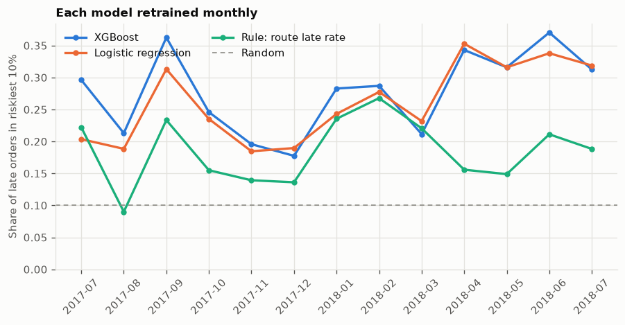
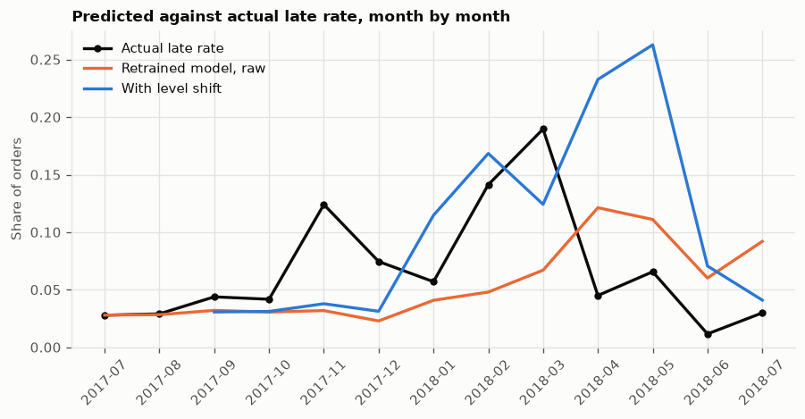

# v1.1: month-by-month comparison

Generated by `make walk-forward` at commit `e73f849`; do not edit by hand. Every model is retrained each month on orders whose outcome was known on the month's first day. **This is not a clean test:** features and parameters were chosen on data up to March 2018, and the months from April 2018 are the v1 test set, already seen. The frozen v1 model is not changed by any of this.

## Ranking across all months

| Model | Mean lift | Mean ROC-AUC | Top-10% recall | Top-10% recall, Apr to Jul 2018 |
| --- | --- | --- | --- | --- |
| Rule: route late rate | 1.870 | 0.622 | 0.185 | 0.176 |
| Logistic regression | 2.365 | 0.691 | 0.261 | 0.331 |
| XGBoost | 2.262 | 0.685 | 0.278 | 0.336 |
| Average of both | 2.509 | 0.704 | 0.276 | 0.323 |
| Logistic regression, recent weighted | 2.363 | 0.694 | 0.262 | 0.318 |
| XGBoost, recent weighted | 2.219 | 0.681 | 0.270 | 0.345 |
| Average of both, recent weighted | 2.461 | 0.703 | 0.272 | 0.319 |

## Late orders caught in the riskiest 10%, by month

| month | orders | late rate | logistic_regression | route_rule | xgboost |
| --- | --- | --- | --- | --- | --- |
| 2017-07 | 3872 | 0.028 | 0.204 | 0.222 | 0.296 |
| 2017-08 | 4193 | 0.029 | 0.189 | 0.090 | 0.213 |
| 2017-09 | 4150 | 0.044 | 0.313 | 0.234 | 0.363 |
| 2017-10 | 4478 | 0.042 | 0.235 | 0.155 | 0.246 |
| 2017-11 | 7288 | 0.124 | 0.185 | 0.139 | 0.196 |
| 2017-12 | 5513 | 0.075 | 0.190 | 0.136 | 0.178 |
| 2018-01 | 7069 | 0.057 | 0.243 | 0.236 | 0.283 |
| 2018-02 | 6555 | 0.141 | 0.278 | 0.268 | 0.287 |
| 2018-03 | 7003 | 0.190 | 0.232 | 0.221 | 0.212 |
| 2018-04 | 6798 | 0.045 | 0.353 | 0.156 | 0.343 |
| 2018-05 | 6749 | 0.066 | 0.316 | 0.149 | 0.316 |
| 2018-06 | 6096 | 0.012 | 0.338 | 0.211 | 0.370 |
| 2018-07 | 2306 | 0.030 | 0.319 | 0.188 | 0.313 |

## Are the differences real?

Each row is one model minus another, month by month. The interval comes from resampling the months, of which there are few.

| Comparison | Metric | Mean difference | 95% low | 95% high | Months ahead |
| --- | --- | --- | --- | --- | --- |
| XGBoost minus Logistic regression | lift | -0.103 | -0.487 | 0.201 | 7 of 13 |
| XGBoost minus Logistic regression | roc_auc | -0.007 | -0.028 | 0.014 | 5 of 13 |
| XGBoost minus Logistic regression | recall_top10 | 0.017 | 0.002 | 0.034 | 8 of 13 |
| Average of both minus XGBoost | lift | 0.247 | 0.004 | 0.603 | 11 of 13 |
| Average of both minus Logistic regression | lift | 0.144 | 0.059 | 0.246 | 11 of 13 |
| Average of both minus XGBoost | roc_auc | 0.019 | 0.006 | 0.035 | 10 of 13 |
| Average of both minus Logistic regression | roc_auc | 0.012 | 0.004 | 0.021 | 11 of 13 |
| Average of both minus XGBoost | recall_top10 | -0.002 | -0.011 | 0.007 | 6 of 13 |
| Average of both minus Logistic regression | recall_top10 | 0.015 | 0.001 | 0.030 | 8 of 13 |
| XGBoost, recent weighted minus XGBoost | recall_top10 | -0.008 | -0.020 | 0.004 | 4 of 13 |
| Logistic regression, recent weighted minus Logistic regression | recall_top10 | 0.001 | -0.012 | 0.012 | 6 of 13 |

## Calibration fix

Months where a correction was available. A level shift moves all of a model's predictions by one number, learned from its own earlier predictions on orders purchased 90 to 30 days before the month starts, using outcomes known by then.

| Months | Model | Correction | Mean gap, predicted vs actual | Brier | ECE |
| --- | --- | --- | --- | --- | --- |
| before April 2018 | Average of both | raw | 0.0570 | 0.0926 | 0.0628 |
| before April 2018 | Average of both | level shift | 0.0433 | 0.0887 | 0.0305 |
| before April 2018 | Average of both | sigmoid | 0.0454 | 0.0896 | 0.0256 |
| before April 2018 | Logistic regression | raw | 0.0564 | 0.0922 | 0.0625 |
| before April 2018 | Logistic regression | level shift | 0.0434 | 0.0884 | 0.0257 |
| before April 2018 | Logistic regression | sigmoid | 0.0446 | 0.0898 | 0.0312 |
| before April 2018 | XGBoost | raw | 0.0548 | 0.0929 | 0.0603 |
| before April 2018 | XGBoost | level shift | 0.0441 | 0.0905 | 0.0296 |
| before April 2018 | XGBoost | sigmoid | 0.0449 | 0.0909 | 0.0249 |
| from April 2018 (v1 test) | Average of both | raw | 0.0581 | 0.0417 | 0.0576 |
| from April 2018 (v1 test) | Average of both | level shift | 0.1137 | 0.0678 | 0.1363 |
| from April 2018 (v1 test) | Average of both | sigmoid | 0.1369 | 0.0855 | 0.1642 |
| from April 2018 (v1 test) | Logistic regression | raw | 0.0646 | 0.0450 | 0.0622 |
| from April 2018 (v1 test) | Logistic regression | level shift | 0.1179 | 0.0736 | 0.1401 |
| from April 2018 (v1 test) | Logistic regression | sigmoid | 0.1269 | 0.0777 | 0.1505 |
| from April 2018 (v1 test) | XGBoost | raw | 0.0593 | 0.0417 | 0.0603 |
| from April 2018 (v1 test) | XGBoost | level shift | 0.1097 | 0.0638 | 0.1318 |
| from April 2018 (v1 test) | XGBoost | sigmoid | 0.1142 | 0.0646 | 0.1368 |

| month | late_rate | raw | level_shift |
| --- | --- | --- | --- |
| 2017-07 | 0.028 | 0.028 | n/a |
| 2017-08 | 0.029 | 0.028 | n/a |
| 2017-09 | 0.044 | 0.032 | 0.031 |
| 2017-10 | 0.042 | 0.031 | 0.031 |
| 2017-11 | 0.124 | 0.032 | 0.038 |
| 2017-12 | 0.075 | 0.023 | 0.031 |
| 2018-01 | 0.057 | 0.041 | 0.115 |
| 2018-02 | 0.141 | 0.048 | 0.168 |
| 2018-03 | 0.190 | 0.067 | 0.124 |
| 2018-04 | 0.045 | 0.121 | 0.233 |
| 2018-05 | 0.066 | 0.111 | 0.263 |
| 2018-06 | 0.012 | 0.060 | 0.071 |
| 2018-07 | 0.030 | 0.092 | 0.041 |
